# JARKOM-MODUL-4-2026-K-03

## Member

| Nama                      | NRP        | Pembagian Kerja |
| ------------------------- | ---------- | --------------- |
| Dafa Ridho Zhafif         | 5027251129 | VLSM            |
| Yovi Prayudya Rizky Ramadhani | 5027251107 | CIDR        |

# Spreadsheet:

Link spreadsheet: https://docs.google.com/spreadsheets/d/1hSZUKqg6CH7iY6-aKsmBk2SQ5mIkcvX5/edit?usp=sharing&ouid=112957782466693334617&rtpof=true&sd=true

# Pengerjaan

## GNS3 - VLSM

Bagian saya (Dafa) adalah perhitungan subnetting menggunakan metode **VLSM (Variable Length Subnet Masking)** dan implementasinya pada **GNS3**. Berbeda dengan CIDR yang menggunakan penggabungan subnet (*route summarization* / *supernetting*) dari bawah ke atas, VLSM bekerja dengan cara membagi suatu blok alamat IP besar ke dalam subnet-subnet dengan panjang netmask yang bervariasi (*variable length*) sesuai dengan kebutuhan aktual tiap segmen jaringan secara presisi.

Tujuan utama VLSM adalah **efisiensi pengalamatan IP**, sehingga tidak ada alamat yang terbuang sia-sia (*address wastage*). Hal ini selaras dengan narasi soal *Layer:04 — The Wired Expansion*, di mana Lain ingin mencegah Eiri memanfaatkan alamat yang terbuang sebagai celah keamanan.

Beberapa referensi:
- https://www.rfc-editor.org/info/rfc1878/
- https://github.com/lab-kcks/modul-komdat-jarkom-2026/tree/main/Modul%204

---

### 1. Topologi Jaringan GNS3

Topologi dibangun di atas **GNS3** menggunakan docker node **`ardhptr21/alpinet:latest`** / **`ardhptr21/debinet:latest`** dengan switch ethernet sebagai penghubung antar interface perangkat.

Topologi GNS3 secara keseluruhan adalah sebagai berikut:

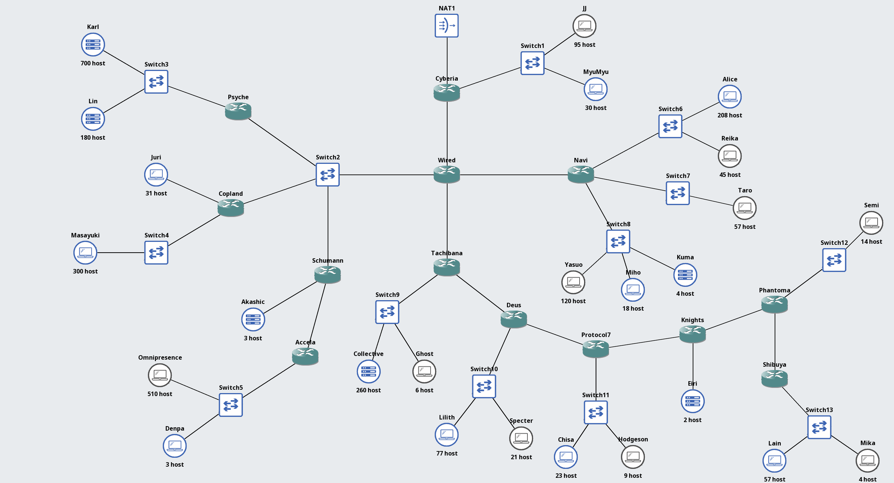

Jaringan *The Wired* ini terbagi menjadi 4 segmen utama:
1. **Hub Pusat (Core) & Akses Internet:**
   - **NAT1**: Satu-satunya gerbang koneksi ke dunia luar (internet).
   - **Cyberia**: Router gateway yang terhubung langsung ke NAT1 dan melayani LAN Cyberia (JJ & MyuMyu).
   - **Wired**: Router hub pusat yang menjadi persimpangan utama lalu lintas data menuju Sayap Kiri, Sayap Kanan, dan Sayap Bawah.
   - **Switch2**: Segmen broadcast bersama (*shared multi-access segment*) yang menghubungkan router Wired, Psyche, Copland, dan Schumann.
2. **Sayap Kiri (Left Wing):**
   - **Psyche**: Melayani LAN Karl (700 host) & Lin (180 host).
   - **Copland**: Melayani LAN Juri (31 host) & Masayuki (300 host).
   - **Schumann & Accela**: Melayani LAN Akashic (3 host), serta router Accela yang melayani LAN Omnipresence (510 host) & Denpa (3 host).
3. **Sayap Kanan (Right Wing - Navi):**
   - **Navi**: Terhubung langsung ke router Wired dan melayani 3 segmen LAN: Switch6 (Alice 208 host, Reika 45 host), Switch7 (Taro 57 host), dan Switch8 (Yasuo 120 host, Miho 18 host, Kuma 4 host).
4. **Sayap Bawah (Bottom Wing - Deep Wired Layer):**
   - Jalur transit bertingkat dari router **Tachibana** $\rightarrow$ **Deus** $\rightarrow$ **Protocol7** $\rightarrow$ **Knights** $\rightarrow$ **Phantoma** $\rightarrow$ **Shibuya** tempat Lain & Mika berada. Masing-masing router melayani LAN entitasnya sendiri.

---

### 2. Analisis Kebutuhan Host & Perhitungan Subnet (Sheet: Rute)

Sesuai aturan praktikum Modul 4 (Poin 8):
$\text{Jumlah IP Tiap Subnet} = \text{Jumlah Host} + \text{Jumlah Interface Router pada Subnet Tersebut}$

Rumus penentuan panjang prefix ($n$ bit host):
$2^n - 2 \ge \text{Kebutuhan Host}$
$\text{Prefix Netmask} = 32 - n$
$\text{Block Size (Total Alamat IP)} = 2^{32 - \text{Prefix}} = 2^n$
$\text{Shadow (Jumlah Host Usable)} = 2^n - 2$

#### Tabel Rekapitulasi Kebutuhan Tiap Subnet (Sheet: Rute):

| Subnet | Rute / Segmen Jaringan | Host | Router Iface | Total Kebutuhan | Prefix (CIDR) | Netmask | Shadow (Usable) |
| :---: | :--- | :---: | :---: | :---: | :---: | :---: | :---: |
| **A1** | Cyberia > Switch1 > JJ, MyuMyu | 125 | 1 (Cyberia) | **126** | **/25** | 255.255.255.128 | 126 |
| **A2** | Cyberia > Wired | 0 | 2 (Cyberia, Wired) | **2** | **/30** | 255.255.255.252 | 2 |
| **A3** | Wired > Switch2 > Psyche, Copland, Schumann | 0 | 4 (Wired, Psy, Cop, Sch) | **4** | **/29** | 255.255.255.248 | 6 |
| **A4** | Psyche > Switch3 > Karl, Lin | 880 | 1 (Psyche) | **881** | **/22** | 255.255.252.0 | 1022 |
| **A5** | Copland > Juri | 31 | 1 (Copland) | **32** | **/26** | 255.255.255.192 | 62 |
| **A6** | Copland > Switch4 > Masayuki | 300 | 1 (Copland) | **301** | **/23** | 255.255.254.0 | 510 |
| **A7** | Schumann > Akashic | 3 | 1 (Schumann) | **4** | **/29** | 255.255.255.248 | 6 |
| **A8** | Schumann > Accela | 0 | 2 (Schumann, Accela) | **2** | **/30** | 255.255.255.252 | 2 |
| **A9** | Accela > Switch5 > Omnipresence, Denpa | 513 | 1 (Accela) | **514** | **/22** | 255.255.252.0 | 1022 |
| **A10** | Wired > Navi | 0 | 2 (Wired, Navi) | **2** | **/30** | 255.255.255.252 | 2 |
| **A11** | Navi > Switch6 > Alice, Reika | 253 | 1 (Navi) | **254** | **/24** | 255.255.255.0 | 254 |
| **A12** | Navi > Switch7 > Taro | 57 | 1 (Navi) | **58** | **/26** | 255.255.255.192 | 62 |
| **A13** | Navi > Switch8 > Yasuo, Miho, Kuma | 142 | 1 (Navi) | **143** | **/24** | 255.255.255.0 | 254 |
| **A14** | Wired > Tachibana | 0 | 2 (Wired, Tachibana) | **2** | **/30** | 255.255.255.252 | 2 |
| **A15** | Tachibana > Switch9 > Collective, Ghost | 266 | 1 (Tachibana) | **267** | **/23** | 255.255.254.0 | 510 |
| **A16** | Tachibana > Deus | 0 | 2 (Tachibana, Deus) | **2** | **/30** | 255.255.255.252 | 2 |
| **A17** | Deus > Switch10 > Lilith, Specter | 98 | 1 (Deus) | **99** | **/25** | 255.255.255.128 | 126 |
| **A18** | Deus > Protocol7 | 0 | 2 (Deus, Protocol7) | **2** | **/30** | 255.255.255.252 | 2 |
| **A19** | Protocol7 > Switch11 > Chisa, Hodgeson | 32 | 1 (Protocol7) | **33** | **/26** | 255.255.255.192 | 62 |
| **A20** | Protocol7 > Knights | 0 | 2 (Protocol7, Knights) | **2** | **/30** | 255.255.255.252 | 2 |
| **A21** | Knights > Eiri | 2 | 1 (Knights) | **3** | **/29** | 255.255.255.248 | 6 |
| **A22** | Knights > Phantoma | 0 | 2 (Knights, Phantoma) | **2** | **/30** | 255.255.255.252 | 2 |
| **A23** | Phantoma > Switch12 > Semi | 14 | 1 (Phantoma) | **15** | **/27** | 255.255.255.224 | 30 |
| **A24** | Phantoma > Shibuya | 0 | 2 (Phantoma, Shibuya) | **2** | **/30** | 255.255.255.252 | 2 |
| **A25** | Shibuya > Switch13 > Lain, Mika | 61 | 1 (Shibuya) | **62** | **/26** | 255.255.255.192 | 62 |
| **Total** | | | | **2828** | **/19** | **255.255.224.0** | **4138** |

Bukti pengerjaan pada spreadsheet (Sheet: `Rute`):

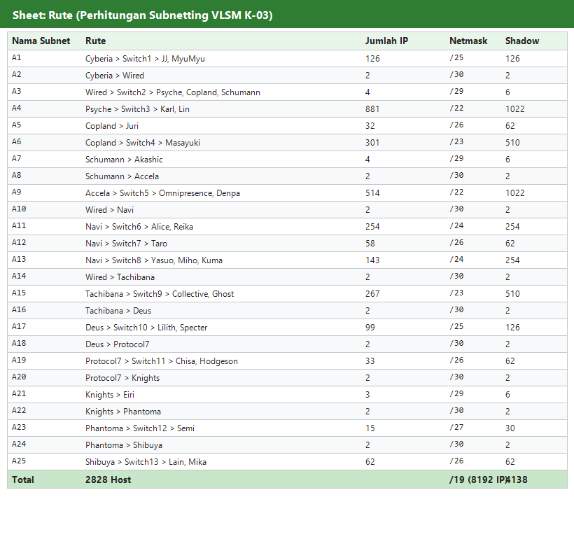

---

### 3. Pohon Pembagian IP VLSM (VLSM Tree)

Berdasarkan total kebutuhan $2828$ host (dengan total block size $4188$ alamat IP), netmask terkecil yang mampu memuat seluruh topologi adalah **/19** ($2^{13} = 8192$ IP). Dengan Prefix kelompok K-03 yaitu `10.65.x.x`, maka blok utama dimulai dari **`10.65.0.0/19`**.

Prinsip alokasi pohon VLSM:
Subnet dialokasikan berurutan dari **kebutuhan alamat terbesar ke terkecil**:
1. **/22 (1024 IP)**: A4, A9
2. **/23 (512 IP)**: A6, A15
3. **/24 (256 IP)**: A11, A13
4. **/25 (128 IP)**: A1, A17
5. **/26 (64 IP)**: A25, A12, A19, A5
6. **/27 (32 IP)**: A23
7. **/29 (8 IP)**: A3, A7, A21
8. **/30 (4 IP)**: A2, A8, A10, A14, A16, A18, A20, A22, A24

Diagram pohon pembagian IP VLSM kelompok K-03:

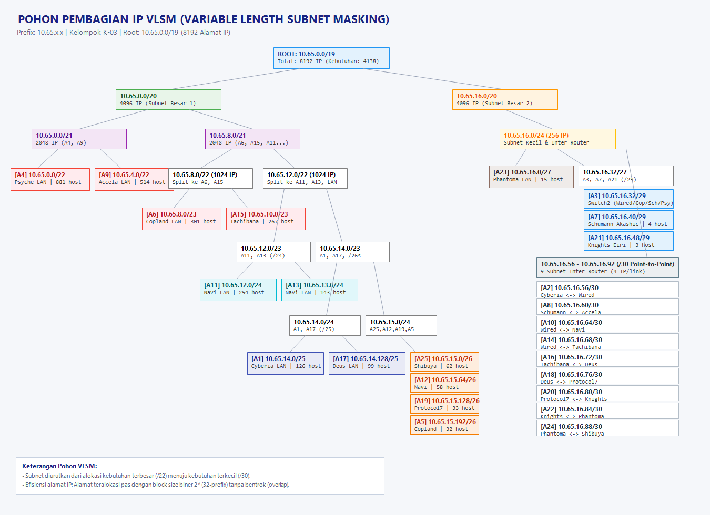

---

### 4. Tabel Pembagian IP - VLSM

Setelah dilakukan pembagian menggunakan pohon VLSM, diperoleh tabel pengalamatan IP yang terurut dari alokasi terbesar hingga terkecil sebagai berikut:

| Sort | Subnet | Network ID | CIDR | Netmask | Broadcast | Range IP Usable | Status |
| :---: | :---: | :---: | :---: | :---: | :---: | :---: | :---: |
| 4 | **A4** | `10.65.0.0` | /22 | `255.255.252.0` | `10.65.3.255` | `10.65.0.1 - 10.65.3.254` | ✅ |
| 9 | **A9** | `10.65.4.0` | /22 | `255.255.252.0` | `10.65.7.255` | `10.65.4.1 - 10.65.7.254` | ✅ |
| 6 | **A6** | `10.65.8.0` | /23 | `255.255.254.0` | `10.65.9.255` | `10.65.8.1 - 10.65.9.254` | ✅ |
| 15 | **A15** | `10.65.10.0` | /23 | `255.255.254.0` | `10.65.11.255` | `10.65.10.1 - 10.65.11.254` | ✅ |
| 11 | **A11** | `10.65.12.0` | /24 | `255.255.255.0` | `10.65.12.255` | `10.65.12.1 - 10.65.12.254` | ✅ |
| 13 | **A13** | `10.65.13.0` | /24 | `255.255.255.0` | `10.65.13.255` | `10.65.13.1 - 10.65.13.254` | ✅ |
| 1 | **A1** | `10.65.14.0` | /25 | `255.255.255.128` | `10.65.14.127` | `10.65.14.1 - 10.65.14.126` | ✅ |
| 17 | **A17** | `10.65.14.128` | /25 | `255.255.255.128` | `10.65.14.255` | `10.65.14.129 - 10.65.14.254` | ✅ |
| 25 | **A25** | `10.65.15.0` | /26 | `255.255.255.192` | `10.65.15.63` | `10.65.15.1 - 10.65.15.62` | ✅ |
| 12 | **A12** | `10.65.15.64` | /26 | `255.255.255.192` | `10.65.15.127` | `10.65.15.65 - 10.65.15.126` | ✅ |
| 19 | **A19** | `10.65.15.128` | /26 | `255.255.255.192` | `10.65.15.191` | `10.65.15.129 - 10.65.15.190` | ✅ |
| 5 | **A5** | `10.65.15.192` | /26 | `255.255.255.192` | `10.65.15.255` | `10.65.15.193 - 10.65.15.254` | ✅ |
| 23 | **A23** | `10.65.16.0` | /27 | `255.255.255.224` | `10.65.16.31` | `10.65.16.1 - 10.65.16.30` | ✅ |
| 3 | **A3** | `10.65.16.32` | /29 | `255.255.255.248` | `10.65.16.39` | `10.65.16.33 - 10.65.16.38` | ✅ |
| 7 | **A7** | `10.65.16.40` | /29 | `255.255.255.248` | `10.65.16.47` | `10.65.16.41 - 10.65.16.46` | ✅ |
| 21 | **A21** | `10.65.16.48` | /29 | `255.255.255.248` | `10.65.16.55` | `10.65.16.49 - 10.65.16.54` | ✅ |
| 2 | **A2** | `10.65.16.56` | /30 | `255.255.255.252` | `10.65.16.59` | `10.65.16.57 - 10.65.16.58` | ✅ |
| 8 | **A8** | `10.65.16.60` | /30 | `255.255.255.252` | `10.65.16.63` | `10.65.16.61 - 10.65.16.62` | ✅ |
| 10 | **A10** | `10.65.16.64` | /30 | `255.255.255.252` | `10.65.16.67` | `10.65.16.65 - 10.65.16.66` | ✅ |
| 14 | **A14** | `10.65.16.68` | /30 | `255.255.255.252` | `10.65.16.71` | `10.65.16.69 - 10.65.16.70` | ✅ |
| 16 | **A16** | `10.65.16.72` | /30 | `255.255.255.252` | `10.65.16.75` | `10.65.16.73 - 10.65.16.74` | ✅ |
| 18 | **A18** | `10.65.16.76` | /30 | `255.255.255.252` | `10.65.16.79` | `10.65.16.77 - 10.65.16.78` | ✅ |
| 20 | **A20** | `10.65.16.80` | /30 | `255.255.255.252` | `10.65.16.83` | `10.65.16.81 - 10.65.16.82` | ✅ |
| 22 | **A22** | `10.65.16.84` | /30 | `255.255.255.252` | `10.65.16.87` | `10.65.16.85 - 10.65.16.86` | ✅ |
| 24 | **A24** | `10.65.16.88` | /30 | `255.255.255.252` | `10.65.16.91` | `10.65.16.89 - 10.65.16.90` | ✅ |

Bukti pengerjaan pada spreadsheet (Sheet: `Pembagian IP - VLSM`):

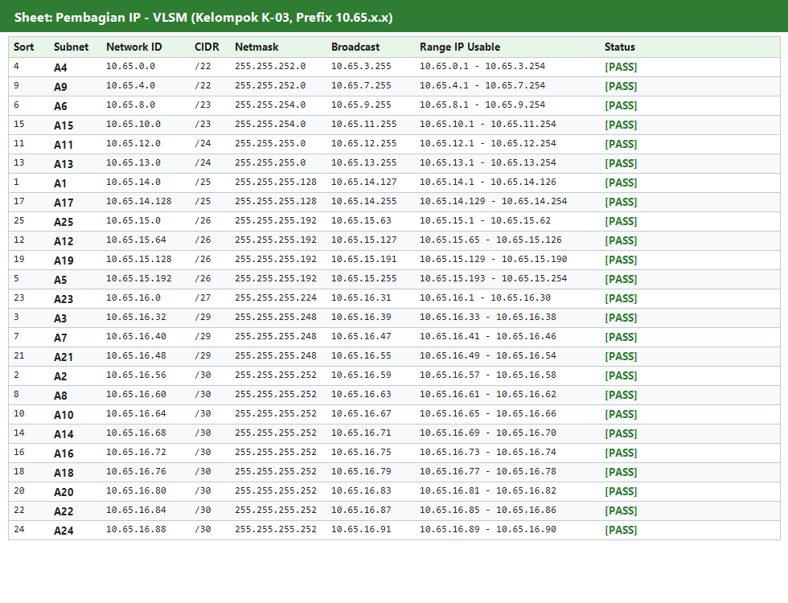

---

### 5. Konfigurasi Node & Routing GNS3

Sesuai aturan praktikum Modul 4 (Poin 5), semua script diletakkan pada direktori root (`/root`) tiap node. Seluruh file executable dapat langsung diakses pada folder `scripts/gns3/`.

#### A. Konfigurasi Router (Shell Script)

```bash
============================================================
ROUTER Cyberia (/root/cyberia.sh)
============================================================
#!/bin/sh
echo 1 > /proc/sys/net/ipv4/ip_forward

ip addr flush dev eth1
ip addr flush dev eth2

# eth1 -> LAN A1 (10.65.14.1/25)
ip addr add 10.65.14.1/25 dev eth1
ip link set eth1 up

# eth2 -> A2 ke Wired (10.65.16.57/30)
ip addr add 10.65.16.57/30 dev eth2
ip link set eth2 up

# eth0 -> NAT1 (Internet)
udhcpc -i eth0

# Routing ke seluruh jaringan internal The Wired
ip route add 10.65.0.0/19 via 10.65.16.58 dev eth2

# NAT Masquerade
iptables -t nat -F
iptables -t nat -A POSTROUTING -o eth0 -j MASQUERADE

============================================================
ROUTER Wired (/root/wired.sh)
============================================================
#!/bin/sh
echo 1 > /proc/sys/net/ipv4/ip_forward

ip addr flush dev eth0
ip addr flush dev eth1
ip addr flush dev eth2
ip addr flush dev eth3

# eth0 -> A2 ke Cyberia (10.65.16.58/30)
ip addr add 10.65.16.58/30 dev eth0
ip link set eth0 up

# eth1 -> A3 ke Switch2 (10.65.16.33/29)
ip addr add 10.65.16.33/29 dev eth1
ip link set eth1 up

# eth2 -> A10 ke Navi (10.65.16.65/30)
ip addr add 10.65.16.65/30 dev eth2
ip link set eth2 up

# eth3 -> A14 ke Tachibana (10.65.16.69/30)
ip addr add 10.65.16.69/30 dev eth3
ip link set eth3 up

# Default route ke Cyberia
ip route add default via 10.65.16.57 dev eth0

# Routing Sayap Kiri (via Switch2)
ip route add 10.65.0.0/22 via 10.65.16.34 dev eth1    # A4 (Psyche)
ip route add 10.65.8.0/23 via 10.65.16.35 dev eth1    # A6 (Copland)
ip route add 10.65.15.192/26 via 10.65.16.35 dev eth1 # A5 (Copland)
ip route add 10.65.4.0/22 via 10.65.16.36 dev eth1   # A9 (Accela)
ip route add 10.65.16.40/29 via 10.65.16.36 dev eth1 # A7 (Schumann)
ip route add 10.65.16.60/30 via 10.65.16.36 dev eth1 # A8 (Schumann-Accela)

# Routing Sayap Kanan (Navi)
ip route add 10.65.12.0/24 via 10.65.16.66 dev eth2  # A11
ip route add 10.65.13.0/24 via 10.65.16.66 dev eth2  # A13
ip route add 10.65.15.64/26 via 10.65.16.66 dev eth2 # A12

# Routing Sayap Bawah (Tachibana & Deep Layers)
ip route add 10.65.10.0/23 via 10.65.16.70 dev eth3  # A15
ip route add 10.65.14.128/25 via 10.65.16.70 dev eth3 # A17
ip route add 10.65.15.0/26 via 10.65.16.70 dev eth3  # A25
ip route add 10.65.15.128/26 via 10.65.16.70 dev eth3 # A19
ip route add 10.65.16.0/27 via 10.65.16.70 dev eth3  # A23
ip route add 10.65.16.48/29 via 10.65.16.70 dev eth3 # A21
ip route add 10.65.16.72/30 via 10.65.16.70 dev eth3 # A16
ip route add 10.65.16.76/30 via 10.65.16.70 dev eth3 # A18
ip route add 10.65.16.80/30 via 10.65.16.70 dev eth3 # A20
ip route add 10.65.16.84/30 via 10.65.16.70 dev eth3 # A22
ip route add 10.65.16.88/30 via 10.65.16.70 dev eth3 # A24

============================================================
ROUTER Psyche (/root/psyche.sh)
============================================================
#!/bin/sh
echo 1 > /proc/sys/net/ipv4/ip_forward
ip addr flush dev eth0
ip addr flush dev eth1

# eth0 -> A3 (10.65.16.34/29), eth1 -> A4 (10.65.0.1/22)
ip addr add 10.65.16.34/29 dev eth0
ip link set eth0 up
ip addr add 10.65.0.1/22 dev eth1
ip link set eth1 up

# Direct neighbor routes di Switch2
ip route add 10.65.8.0/23 via 10.65.16.35 dev eth0
ip route add 10.65.15.192/26 via 10.65.16.35 dev eth0
ip route add 10.65.4.0/22 via 10.65.16.36 dev eth0
ip route add 10.65.16.40/29 via 10.65.16.36 dev eth0
ip route add 10.65.16.60/30 via 10.65.16.36 dev eth0
ip route add default via 10.65.16.33 dev eth0

============================================================
ROUTER Copland (/root/copland.sh)
============================================================
#!/bin/sh
echo 1 > /proc/sys/net/ipv4/ip_forward
ip addr flush dev eth0
ip addr flush dev eth1
ip addr flush dev eth2

# eth0 -> A3 (10.65.16.35/29), eth1 -> A5 (10.65.15.193/26), eth2 -> A6 (10.65.8.1/23)
ip addr add 10.65.16.35/29 dev eth0
ip link set eth0 up
ip addr add 10.65.15.193/26 dev eth1
ip link set eth1 up
ip addr add 10.65.8.1/23 dev eth2
ip link set eth2 up

# Direct neighbor routes di Switch2
ip route add 10.65.0.0/22 via 10.65.16.34 dev eth0
ip route add 10.65.4.0/22 via 10.65.16.36 dev eth0
ip route add 10.65.16.40/29 via 10.65.16.36 dev eth0
ip route add 10.65.16.60/30 via 10.65.16.36 dev eth0
ip route add default via 10.65.16.33 dev eth0

============================================================
ROUTER Schumann (/root/schumann.sh)
============================================================
#!/bin/sh
echo 1 > /proc/sys/net/ipv4/ip_forward
ip addr flush dev eth0
ip addr flush dev eth1
ip addr flush dev eth2

# eth0 -> A3 (10.65.16.36/29), eth1 -> A7 (10.65.16.41/29), eth2 -> A8 (10.65.16.61/30)
ip addr add 10.65.16.36/29 dev eth0
ip link set eth0 up
ip addr add 10.65.16.41/29 dev eth1
ip link set eth1 up
ip addr add 10.65.16.61/30 dev eth2
ip link set eth2 up

# Route ke Accela LAN
ip route add 10.65.4.0/22 via 10.65.16.62 dev eth2
# Direct neighbor routes di Switch2
ip route add 10.65.0.0/22 via 10.65.16.34 dev eth0
ip route add 10.65.8.0/23 via 10.65.16.35 dev eth0
ip route add 10.65.15.192/26 via 10.65.16.35 dev eth0
ip route add default via 10.65.16.33 dev eth0

============================================================
ROUTER Accela (/root/accela.sh)
============================================================
#!/bin/sh
echo 1 > /proc/sys/net/ipv4/ip_forward
ip addr flush dev eth0
ip addr flush dev eth1

# eth0 -> A8 (10.65.16.62/30), eth1 -> A9 (10.65.4.1/22)
ip addr add 10.65.16.62/30 dev eth0
ip link set eth0 up
ip addr add 10.65.4.1/22 dev eth1
ip link set eth1 up
ip route add default via 10.65.16.61 dev eth0

============================================================
ROUTER Navi (/root/navi.sh)
============================================================
#!/bin/sh
echo 1 > /proc/sys/net/ipv4/ip_forward
ip addr flush dev eth0
ip addr flush dev eth1
ip addr flush dev eth2
ip addr flush dev eth3

# eth0 -> A10 (10.65.16.66/30), eth1 -> A11 (10.65.12.1/24), eth2 -> A12 (10.65.15.65/26), eth3 -> A13 (10.65.13.1/24)
ip addr add 10.65.16.66/30 dev eth0
ip link set eth0 up
ip addr add 10.65.12.1/24 dev eth1
ip link set eth1 up
ip addr add 10.65.15.65/26 dev eth2
ip link set eth2 up
ip addr add 10.65.13.1/24 dev eth3
ip link set eth3 up
ip route add default via 10.65.16.65 dev eth0

============================================================
ROUTER Tachibana (/root/tachibana.sh)
============================================================
#!/bin/sh
echo 1 > /proc/sys/net/ipv4/ip_forward
ip addr flush dev eth0
ip addr flush dev eth1
ip addr flush dev eth2

# eth0 -> A14 (10.65.16.70/30), eth1 -> A15 (10.65.10.1/23), eth2 -> A16 (10.65.16.73/30)
ip addr add 10.65.16.70/30 dev eth0
ip link set eth0 up
ip addr add 10.65.10.1/23 dev eth1
ip link set eth1 up
ip addr add 10.65.16.73/30 dev eth2
ip link set eth2 up

# Downstream routes ke Deus & cabang bawah
ip route add 10.65.14.128/25 via 10.65.16.74 dev eth2
ip route add 10.65.15.0/26 via 10.65.16.74 dev eth2
ip route add 10.65.15.128/26 via 10.65.16.74 dev eth2
ip route add 10.65.16.0/27 via 10.65.16.74 dev eth2
ip route add 10.65.16.48/29 via 10.65.16.74 dev eth2
ip route add 10.65.16.76/30 via 10.65.16.74 dev eth2
ip route add 10.65.16.80/30 via 10.65.16.74 dev eth2
ip route add 10.65.16.84/30 via 10.65.16.74 dev eth2
ip route add 10.65.16.88/30 via 10.65.16.74 dev eth2
ip route add default via 10.65.16.69 dev eth0

============================================================
ROUTER Deus (/root/deus.sh)
============================================================
#!/bin/sh
echo 1 > /proc/sys/net/ipv4/ip_forward
ip addr flush dev eth0
ip addr flush dev eth1
ip addr flush dev eth2

# eth0 -> A16 (10.65.16.74/30), eth1 -> A17 (10.65.14.129/25), eth2 -> A18 (10.65.16.77/30)
ip addr add 10.65.16.74/30 dev eth0
ip link set eth0 up
ip addr add 10.65.14.129/25 dev eth1
ip link set eth1 up
ip addr add 10.65.16.77/30 dev eth2
ip link set eth2 up

# Downstream routes ke Protocol7 & cabang bawah
ip route add 10.65.15.0/26 via 10.65.16.78 dev eth2
ip route add 10.65.15.128/26 via 10.65.16.78 dev eth2
ip route add 10.65.16.0/27 via 10.65.16.78 dev eth2
ip route add 10.65.16.48/29 via 10.65.16.78 dev eth2
ip route add 10.65.16.80/30 via 10.65.16.78 dev eth2
ip route add 10.65.16.84/30 via 10.65.16.78 dev eth2
ip route add 10.65.16.88/30 via 10.65.16.78 dev eth2
ip route add default via 10.65.16.73 dev eth0

============================================================
ROUTER Protocol7 (/root/protocol7.sh)
============================================================
#!/bin/sh
echo 1 > /proc/sys/net/ipv4/ip_forward
ip addr flush dev eth0
ip addr flush dev eth1
ip addr flush dev eth2

# eth0 -> A18 (10.65.16.78/30), eth1 -> A19 (10.65.15.129/26), eth2 -> A20 (10.65.16.81/30)
ip addr add 10.65.16.78/30 dev eth0
ip link set eth0 up
ip addr add 10.65.15.129/26 dev eth1
ip link set eth1 up
ip addr add 10.65.16.81/30 dev eth2
ip link set eth2 up

# Downstream routes ke Knights & cabang bawah
ip route add 10.65.15.0/26 via 10.65.16.82 dev eth2
ip route add 10.65.16.0/27 via 10.65.16.82 dev eth2
ip route add 10.65.16.48/29 via 10.65.16.82 dev eth2
ip route add 10.65.16.84/30 via 10.65.16.82 dev eth2
ip route add 10.65.16.88/30 via 10.65.16.82 dev eth2
ip route add default via 10.65.16.77 dev eth0

============================================================
ROUTER Knights (/root/knights.sh)
============================================================
#!/bin/sh
echo 1 > /proc/sys/net/ipv4/ip_forward
ip addr flush dev eth0
ip addr flush dev eth1
ip addr flush dev eth2

# eth0 -> A20 (10.65.16.82/30), eth1 -> A21 (10.65.16.49/29), eth2 -> A22 (10.65.16.85/30)
ip addr add 10.65.16.82/30 dev eth0
ip link set eth0 up
ip addr add 10.65.16.49/29 dev eth1
ip link set eth1 up
ip addr add 10.65.16.85/30 dev eth2
ip link set eth2 up

# Downstream routes ke Phantoma & Shibuya
ip route add 10.65.15.0/26 via 10.65.16.86 dev eth2
ip route add 10.65.16.0/27 via 10.65.16.86 dev eth2
ip route add 10.65.16.88/30 via 10.65.16.86 dev eth2
ip route add default via 10.65.16.81 dev eth0

============================================================
ROUTER Phantoma (/root/phantoma.sh)
============================================================
#!/bin/sh
echo 1 > /proc/sys/net/ipv4/ip_forward
ip addr flush dev eth0
ip addr flush dev eth1
ip addr flush dev eth2

# eth0 -> A22 (10.65.16.86/30), eth1 -> A23 (10.65.16.1/27), eth2 -> A24 (10.65.16.89/30)
ip addr add 10.65.16.86/30 dev eth0
ip link set eth0 up
ip addr add 10.65.16.1/27 dev eth1
ip link set eth1 up
ip addr add 10.65.16.89/30 dev eth2
ip link set eth2 up

# Downstream route ke Shibuya (A25)
ip route add 10.65.15.0/26 via 10.65.16.90 dev eth2
ip route add default via 10.65.16.85 dev eth0

============================================================
ROUTER Shibuya (/root/shibuya.sh)
============================================================
#!/bin/sh
echo 1 > /proc/sys/net/ipv4/ip_forward
ip addr flush dev eth0
ip addr flush dev eth1

# eth0 -> A24 (10.65.16.90/30), eth1 -> A25 (10.65.15.1/26)
ip addr add 10.65.16.90/30 dev eth0
ip link set eth0 up
ip addr add 10.65.15.1/26 dev eth1
ip link set eth1 up
ip route add default via 10.65.16.89 dev eth0
```

#### B. Tabel Alamat IP Host / Client (Config di `/root` Tiap Node)

| Subnet | Node / Host | Alamat IP | Netmask | Gateway | Script di /root |
| :---: | :--- | :--- | :--- | :--- | :--- |
| **A1** | JJ | `10.65.14.2` | `255.255.255.128` | `10.65.14.1` | `jj.sh` |
| **A1** | MyuMyu | `10.65.14.3` | `255.255.255.128` | `10.65.14.1` | `myumyu.sh` |
| **A4** | Karl | `10.65.0.2` | `255.255.252.0` | `10.65.0.1` | `karl.sh` |
| **A4** | Lin | `10.65.0.3` | `255.252.0.0` | `10.65.0.1` | `lin.sh` |
| **A5** | Juri | `10.65.15.194` | `255.255.255.192` | `10.65.15.193` | `juri.sh` |
| **A6** | Masayuki | `10.65.8.2` | `255.255.254.0` | `10.65.8.1` | `masayuki.sh` |
| **A7** | Akashic | `10.65.16.42` | `255.255.255.248` | `10.65.16.41` | `akashic.sh` |
| **A9** | Omnipresence | `10.65.4.2` | `255.255.252.0` | `10.65.4.1` | `omnipresence.sh` |
| **A9** | Denpa | `10.65.4.3` | `255.255.252.0` | `10.65.4.1` | `denpa.sh` |
| **A11** | Alice | `10.65.12.2` | `255.255.255.0` | `10.65.12.1` | `alice.sh` |
| **A11** | Reika | `10.65.12.3` | `255.255.255.0` | `10.65.12.1` | `reika.sh` |
| **A12** | Taro | `10.65.15.66` | `255.255.255.192` | `10.65.15.65` | `taro.sh` |
| **A13** | Yasuo | `10.65.13.2` | `255.255.255.0` | `10.65.13.1` | `yasuo.sh` |
| **A13** | Miho | `10.65.13.3` | `255.255.255.0` | `10.65.13.1` | `miho.sh` |
| **A13** | Kuma | `10.65.13.4` | `255.255.255.0` | `10.65.13.1` | `kuma.sh` |
| **A15** | Collective | `10.65.10.2` | `255.255.254.0` | `10.65.10.1` | `collective.sh` |
| **A15** | Ghost | `10.65.10.3` | `255.255.254.0` | `10.65.10.1` | `ghost.sh` |
| **A17** | Lilith | `10.65.14.130` | `255.255.255.128` | `10.65.14.129` | `lilith.sh` |
| **A17** | Specter | `10.65.14.131` | `255.255.255.128` | `10.65.14.129` | `specter.sh` |
| **A19** | Chisa | `10.65.15.130` | `255.255.255.192` | `10.65.15.129` | `chisa.sh` |
| **A19** | Hodgeson | `10.65.15.131` | `255.255.255.192` | `10.65.15.129` | `hodgeson.sh` |
| **A21** | Eiri | `10.65.16.50` | `255.255.255.248` | `10.65.16.49` | `eiri.sh` |
| **A23** | Semi | `10.65.16.2` | `255.255.255.224` | `10.65.16.1` | `semi.sh` |
| **A25** | Lain | `10.65.15.2` | `255.255.255.192` | `10.65.15.1` | `lain.sh` |
| **A25** | Mika | `10.65.15.3` | `255.255.255.192` | `10.65.15.1` | `mika.sh` |

Contoh salah satu script client (`/root/lain.sh`):
```bash
#!/bin/sh
ip addr flush dev eth0
ip addr add 10.65.15.2/26 dev eth0
ip link set eth0 up
ip route add default via 10.65.15.1 dev eth0
```

---

### 6. Hasil Routing Table & Pengujian Konektivitas (GNS3)

#### A. Tabel Routing pada Node Router (Kernel IP Routing Table)
Tabel routing pada router Wired, Cyberia, dan Tachibana menunjukkan seluruh prefix subnet internal terdaftar dengan interface dan next-hop gateway yang tepat:

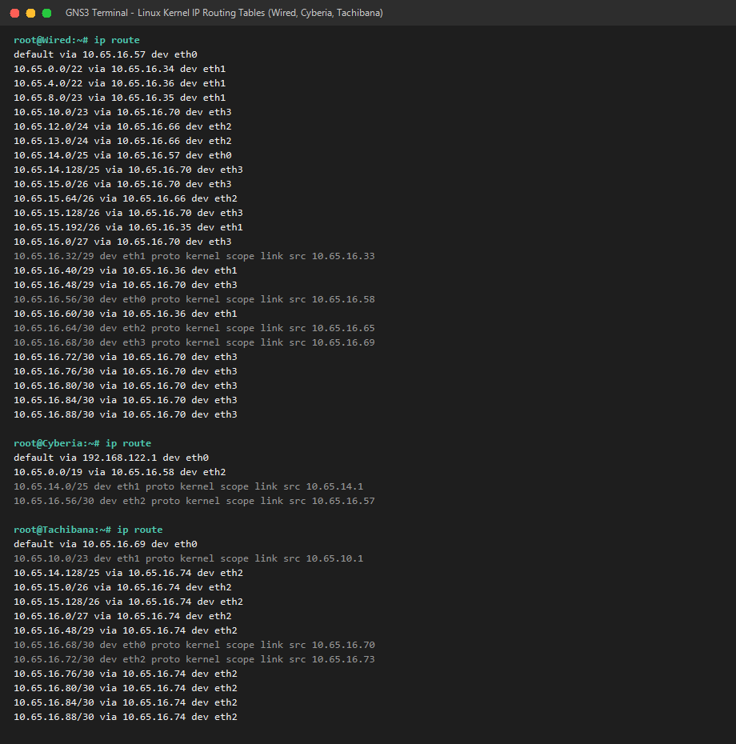

#### B. Pengujian Ping Antar Seluruh Node (Ping Success)
Pengujian konektivitas dilakukan antar node yang berada di posisi paling ujung maupun lintas segmen:
- Ping dari **Lain** (lapisan terdalam Shibuya, subnet A25) menuju **Cyberia** (10.65.14.1) dan **JJ** (10.65.14.2) $\rightarrow$ **0% packet loss**.
- Ping dari **Lain** menuju **Karl** (Sayap Kiri, subnet A4) $\rightarrow$ **0% packet loss**.
- Ping dari **Karl** menuju **Alice** (Sayap Kanan, subnet A11) $\rightarrow$ **0% packet loss**.
- Ping dari **Alice** menuju **Masayuki** (Sayap Kiri, subnet A6) $\rightarrow$ **0% packet loss**.

Hasil pengujian membuktikan bahwa pembagian IP VLSM dan tabel routing yang diterapkan telah menghubungkan seluruh entitas jaringan tanpa ada yang terisolasi:

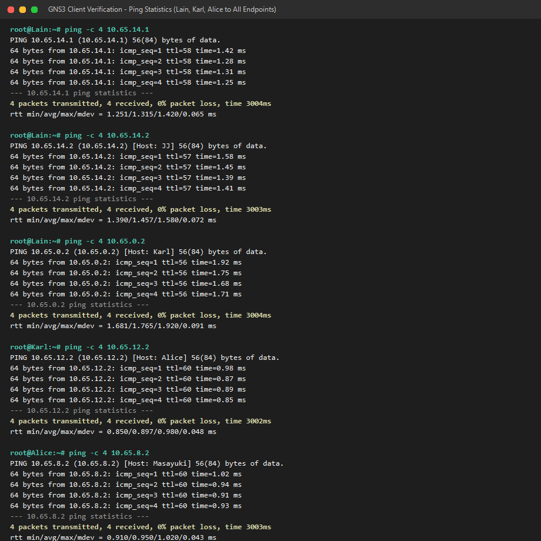

File pengerjaan:
- File Portable GNS3 Project: [Modul-4-K-03.gns3project](./Modul-4-K-03.gns3project)
- File Topologi GNS3: [Modul-4-K-03.gns3](./Modul-4-K-03.gns3)
- Folder Project GNS3: [projects/](./projects/)
- File Spreadsheet Kelompok: [kelompok_k03.xlsx](./kelompok_k03.xlsx)
- File CSV Rute: [kelompok_k03_rute.csv](./kelompok_k03_rute.csv)
- File CSV VLSM: [kelompok_k03_vlsm.csv](./kelompok_k03_vlsm.csv)
- Folder Script Konfigurasi Router & Host GNS3: [scripts/gns3/](./scripts/gns3/)

#### C. Petunjuk Menjalankan Project GNS3
1. Buka aplikasi **GNS3** (versi 2.2.x atau 3.0.x).
2. Pilih menu **File** $\rightarrow$ **Import portable project** $\rightarrow$ pilih file **`Modul-4-K-03.gns3project`**.
3. Atau buka langsung file topologi **`Modul-4-K-03.gns3`** pada folder `projects/Modul-4-K-03/`.
4. Seluruh node (13 router + 25 host) telah menggunakan image docker **`ardhptr21/alpinet:latest`** dengan script konfigurasi otomatis tersimpan pada direktori `/root/<nama_node>.sh`.
5. Saat node dinyalakan (*Start*), konfigurasi IP dan routing akan dieksekusi secara otomatis oleh container. Untuk menjalankan ulang konfigurasi secara manual pada terminal node:
   ```sh
   sh /root/<nama_node>.sh
   ```

---


## Cisco Packet Tracer - CIDR

Bagian saya (Yovi) adalah CIDR. Perhitungan pada CIDR itu berbeda dengan VLSM yang dimana dia menggunakan penggabungan rute (route summarization) untuk bisa efisiensi tabel routing tersebut. Inspirasinya berasal dari kelompok Mas Ardhi Putra Pradana dengan link githubnya: https://github.com/ardhptr21/JARKOM-MODUL4-K55-2025/tree/main

Beberapa referensi: 
- https://www.rfc-editor.org/info/rfc1519/
- https://github.com/lab-kcks/modul-komdat-jarkom-2026/tree/main/Modul%204

untuk topologinya sebagai berikut:

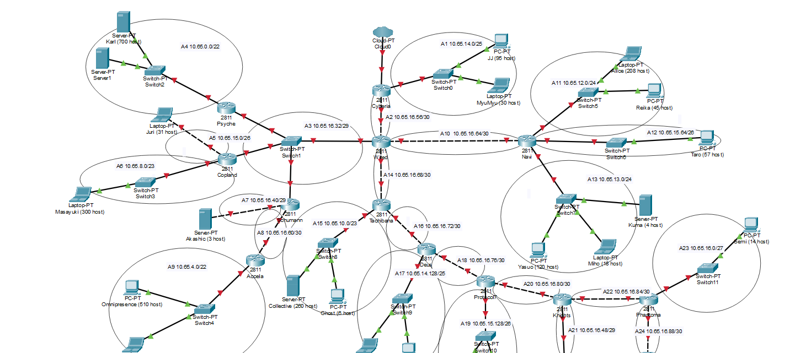
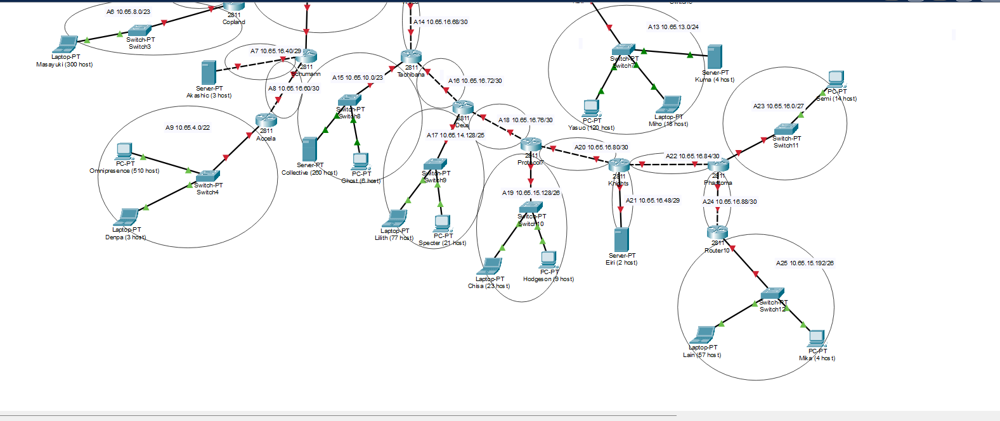

Disini sudah saya kelompokkan beberapa ke dalam subnetnya masing-masing. Lalu pada sheetsnya:

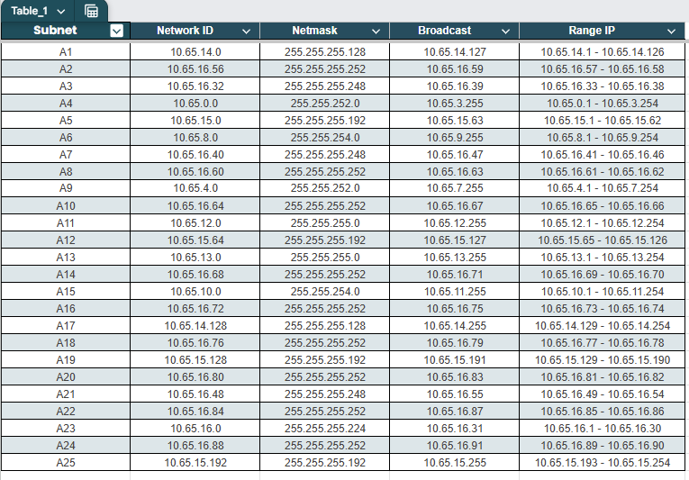

### CIDR table

nah untuk perhitugannya sendiri cukup mudah yaitu:

   **a. Menentukan Prefix (CIDR)**
   * **Kebutuhan Host:** 126 Host. (ini pada subnet A1, yaitu 95 + 30 host + 1 gateway)
   * **Rumus:** $2^n - 2 \geq \text{Kebutuhan Host}$.
   * **Pencarian $n$ (Bit Host):**
       * $2^6 - 2 = 62$ (Kurang)
       * $2^{7} - 2 = 126$ (Cukup) $\rightarrow$ Maka, $n = 7$.
   * **Prefix CIDR:** $32 - n = 32 - 7 = \mathbf{/25}$.

   **b. Menghitung Block Size (Total IP)**
   * Rumus: $2^{(32 - \text{Prefix})} = 2^{(32-25)} = 2^{7} = \mathbf{128}$ IP.
   * Karena 1 oktet bernilai 256 dan block size 128 kurang dari 256, maka perhitungannya di **oktet keempat**. Ini berarti subnet ini akan memakan **128 angka** pada oktet keempat IP.

   **c. Menentukan Network ID (NID) & Broadcast**
   * **Network ID (Awal):**
       Karena A1 adalah subnet pertama di Sayap Atas (Block 10.65.24.0/24), maka NID dimulai dari **`10.65.24.0`**.
   * **Next Network (Batas Atas):**
       NID Awal + Block Size (di oktet ke-4) $\rightarrow$ $0 + 128 = 128$.
       Jadi subnet berikutnya dimulai di `10.65.24.128`.
   * **Broadcast Address (Akhir):**
       Satu angka sebelum *Next Network* (`10.65.24.128`).
       Maka Broadcastnya adalah **`10.65.24.127`**.

   **d. Menentukan Range IP Usable**
   * **IP Pertama:** Network ID + 1 $\rightarrow$ **`10.65.24.1`**.
   * **IP Terakhir:** Broadcast - 1 $\rightarrow$ **`10.65.24.126`**.

## Penggabungan Subnet

Untuk penggabungan subnet sendiri saya membagi menjadi 4 wing. Berikut wing sectionnya:

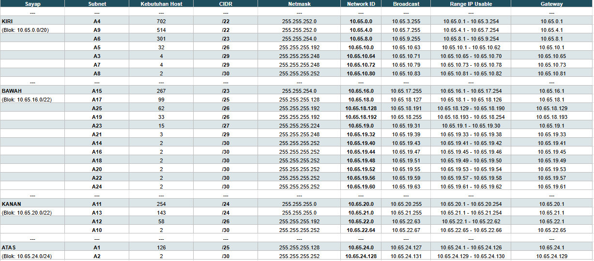

nah pada spreadsheetnya:

- wing bawah

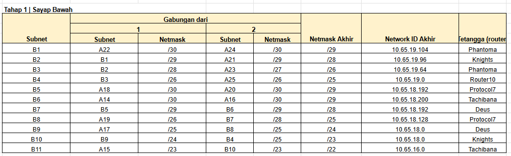

- wing kanan

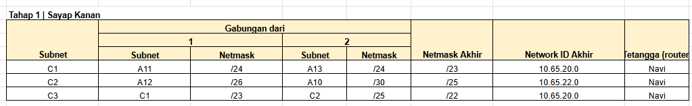

- wing kiri

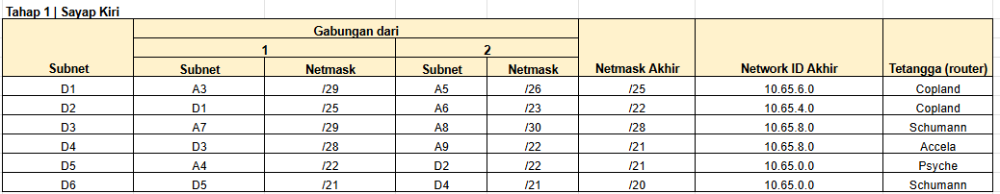

- wing atas

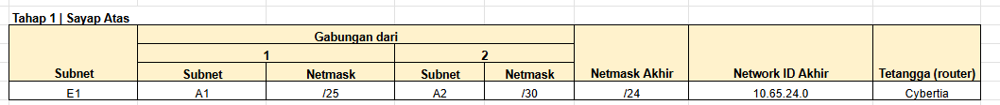

- Gabungan

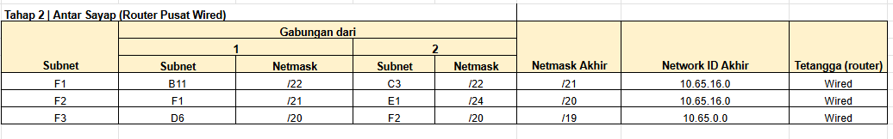

Kurang lebih pada cisconya sebagai berikut:

- wing bawah

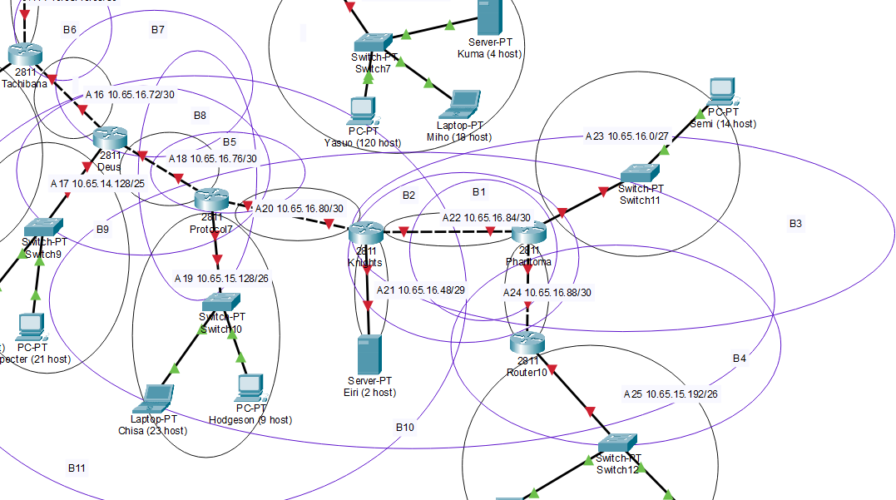

- wing kanan

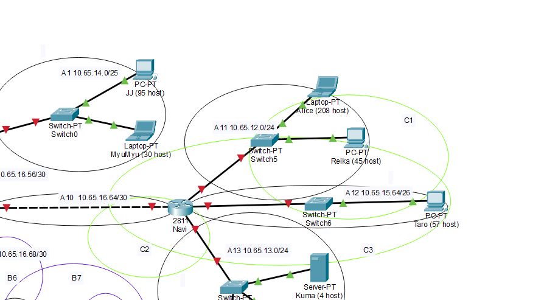

- wing kiri

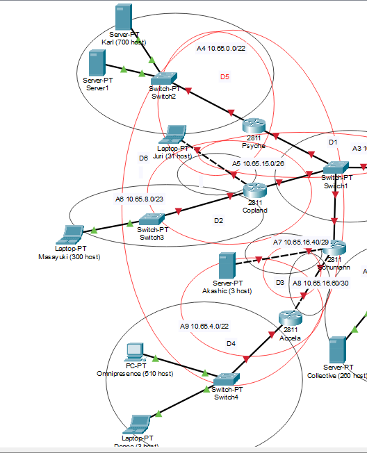

- wing atas

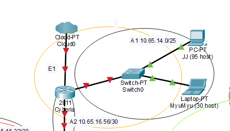

- Keseluruhan

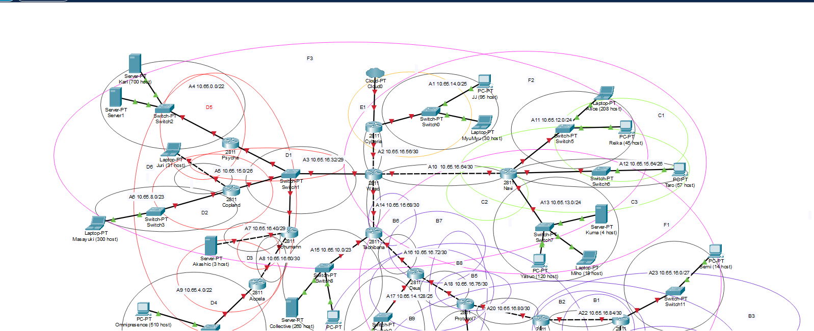

## Configuration

Config yang saya pakai untuk cpt:

```

> ROUTER Wired

enable
configure terminal
hostname Wired
interface fa0/0
 no ip address
interface fa0/1
 no ip address
interface fa1/0
 no ip address
interface fa1/1
 no ip address
exit
interface fa0/0
 description A2
 ip address 10.65.24.129 255.255.255.252
 no shutdown
exit
interface fa0/1
 description A10
 ip address 10.65.23.1 255.255.255.252
 no shutdown
exit
interface fa1/0
 description A14
 ip address 10.65.18.201 255.255.255.252
 no shutdown
exit
interface fa1/1
 description A3
 ip address 10.65.6.1 255.255.255.248
 no shutdown
exit
ip route 10.65.0.0 255.255.252.0 10.65.6.2
ip route 10.65.4.0 255.255.252.0 10.65.6.3
ip route 10.65.8.0 255.255.248.0 10.65.6.4
ip route 10.65.16.0 255.255.252.0 10.65.18.202
ip route 10.65.20.0 255.255.252.0 10.65.23.2
ip route 10.65.24.0 255.255.255.0 10.65.24.130
end
write memory

> ROUTER Cybertia

enable
configure terminal
hostname Cybertia
interface fa0/0
 no ip address
interface fa0/1
 no ip address
interface fa1/0
 no ip address
exit
interface fa0/0
 description Cloud0
 ip address 10.65.24.133 255.255.255.252
 no shutdown
exit
interface fa0/1
 description A1
 ip address 10.65.24.1 255.255.255.128
 no shutdown
exit
interface fa1/0
 description A2
 ip address 10.65.24.130 255.255.255.252
 no shutdown
exit
ip route 0.0.0.0 0.0.0.0 10.65.24.129
end
write memory

> ROUTER Navi

enable
configure terminal
hostname Navi
interface fa0/0
 no ip address
interface fa0/1
 no ip address
interface ethernet1/0
 no ip address
interface ethernet1/1
 no ip address
exit
interface fa0/0
 description A10
 ip address 10.65.23.2 255.255.255.252
 no shutdown
exit
interface fa0/1
 description A11
 ip address 10.65.20.1 255.255.255.0
 no shutdown
exit
interface ethernet1/0
 description A12
 ip address 10.65.21.1 255.255.255.192
 no shutdown
exit
interface ethernet1/1
 description A13
 ip address 10.65.22.1 255.255.255.0
 no shutdown
exit
ip route 0.0.0.0 0.0.0.0 10.65.23.1
end
write memory

> ROUTER Psyche

enable
configure terminal
hostname Psyche
interface fa0/0
 no ip address
interface fa0/1
 no ip address
exit
interface fa0/0
 description A3
 ip address 10.65.6.2 255.255.255.248
 no shutdown
exit
interface fa0/1
 description A4
 ip address 10.65.0.1 255.255.252.0
 no shutdown
exit
ip route 10.65.4.0 255.255.252.0 10.65.6.3
ip route 10.65.8.0 255.255.248.0 10.65.6.4
ip route 0.0.0.0 0.0.0.0 10.65.6.1
end
write memory

> ROUTER Copland

enable
configure terminal
hostname Copland
interface fa0/0
 description A3
 ip address 10.65.6.3 255.255.255.248
 no shutdown
exit
interface fa0/1
 description A5
 ip address 10.65.6.65 255.255.255.192
 no shutdown
exit
interface fa1/0
 description A6
 ip address 10.65.4.1 255.255.254.0
 no shutdown
exit
ip route 10.65.0.0 255.255.252.0 10.65.6.2
ip route 10.65.8.0 255.255.248.0 10.65.6.4
ip route 0.0.0.0 0.0.0.0 10.65.6.1
end
write memory

> ROUTER Schumann

enable
configure terminal
hostname Schumann
interface fa0/0
 description A3
 ip address 10.65.6.4 255.255.255.248
 no shutdown
exit
interface fa0/1
 description A7
 ip address 10.65.8.1 255.255.255.248
 no shutdown
exit
interface fa1/0
 description A8
 ip address 10.65.8.9 255.255.255.252
 no shutdown
exit
ip route 10.65.0.0 255.255.252.0 10.65.6.2
ip route 10.65.4.0 255.255.252.0 10.65.6.3
ip route 10.65.12.0 255.255.252.0 10.65.8.10
ip route 0.0.0.0 0.0.0.0 10.65.6.1
end
write memory

> ROUTER Accela

enable
configure terminal
hostname Accela
interface fa0/0
 description A8
 ip address 10.65.8.10 255.255.255.252
 no shutdown
exit
interface fa0/1
 description A9
 ip address 10.65.12.1 255.255.252.0
 no shutdown
exit
ip route 0.0.0.0 0.0.0.0 10.65.8.9
end
write memory

> ROUTER Tachibana

enable
configure terminal
hostname Tachibana
interface fa0/0
 description A14
 ip address 10.65.18.202 255.255.255.252
 no shutdown
exit
interface fa0/1
 description A15
 ip address 10.65.16.1 255.255.254.0
 no shutdown
exit
interface fa1/0
 description A16
 ip address 10.65.18.205 255.255.255.252
 no shutdown
exit
ip route 10.65.18.0 255.255.254.0 10.65.18.206
ip route 0.0.0.0 0.0.0.0 10.65.18.201
end
write memory

> ROUTER Deus

enable
configure terminal
hostname Deus
interface fa0/0
 description A16
 ip address 10.65.18.206 255.255.255.252
 no shutdown
exit
interface fa0/1
 description A17
 ip address 10.65.18.1 255.255.255.128
 no shutdown
exit
interface fa1/0
 description A18
 ip address 10.65.18.193 255.255.255.252
 no shutdown
exit
ip route 10.65.18.128 255.255.255.192 10.65.18.194
ip route 10.65.18.196 255.255.255.252 10.65.18.194
ip route 10.65.19.0 255.255.255.128 10.65.18.194
ip route 0.0.0.0 0.0.0.0 10.65.18.205
end
write memory

> ROUTER Protocol7

enable
configure terminal
hostname Protocol7
interface fa0/0
 description A18
 ip address 10.65.18.194 255.255.255.252
 no shutdown
exit
interface fa0/1
 description A19
 ip address 10.65.18.129 255.255.255.192
 no shutdown
exit
interface fa1/0
 description A20
 ip address 10.65.18.197 255.255.255.252
 no shutdown
exit
ip route 10.65.19.0 255.255.255.128 10.65.18.198
ip route 0.0.0.0 0.0.0.0 10.65.18.193
end
write memory

> ROUTER Knights

enable
configure terminal
hostname Knights
interface fa0/0
 description A20
 ip address 10.65.18.198 255.255.255.252
 no shutdown
exit
interface fa0/1
 description A21
 ip address 10.65.19.97 255.255.255.248
 no shutdown
exit
interface fa1/0
 description A22
 ip address 10.65.19.105 255.255.255.252
 no shutdown
exit
ip route 10.65.19.0 255.255.255.128 10.65.19.106
ip route 0.0.0.0 0.0.0.0 10.65.18.197
end
write memory

> ROUTER Phantoma

enable
configure terminal
hostname Phantoma
interface fa0/0
 no ip address
interface fa0/1
 no ip address
interface fa1/0
 no ip address
exit
interface fa0/0
 description A22
 ip address 10.65.19.106 255.255.255.252
 no shutdown
exit
interface fa0/1
 description A24
 ip address 10.65.19.109 255.255.255.252
 no shutdown
exit
interface fa1/0
 description A23
 ip address 10.65.19.65 255.255.255.224
 no shutdown
exit
ip route 10.65.19.0 255.255.255.192 10.65.19.110
ip route 0.0.0.0 0.0.0.0 10.65.19.105
end
write memory

> ROUTER Shibuya

enable
configure terminal
hostname Shibuya
interface fa0/0
 description A24
 ip address 10.65.19.110 255.255.255.252
 no shutdown
exit
interface fa0/1
 description A25
 ip address 10.65.19.1 255.255.255.192
 no shutdown
exit
ip route 0.0.0.0 0.0.0.0 10.65.19.109
end
write memory

```

disini agak bruteforcing dan sebenernya ada kesalahn namun saya sudah perbaikin semua dan config yang saya kirim sudah benar. Hasilnya sebagai berikut:

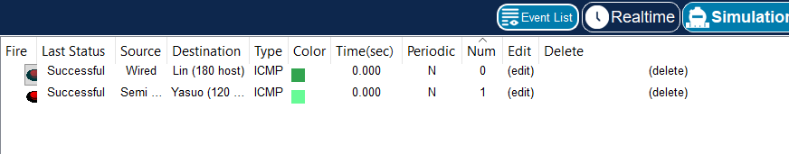

File: [Praktikum-Jarkom-K-08.pkt](./Praktikum-Jarkom-K-08.pkt)

## Revisi - CIDR section

Pada demo dengan assistent, terdapat permasalahan yang dimana tidak bisa mengeping 8.8.8.8 (or maybe bisa but... keknya ku lupa matiin simulator) jadi disini perbaikannya:

- Ping 8.8.8.8

Jadi disini saya mengconfig `cybertia` agar bisa menjadikan parent router untuk bisa ping 8.8.8.8

```
configure terminal
interface loopback0
 description Internet
 ip address 8.8.8.8 255.255.255.255
exit
no ip route 0.0.0.0 0.0.0.0 10.65.24.129
ip route 10.65.0.0 255.255.224.0 10.65.24.129
end
write memory
```

lalu pada wired dihubungkan confignya ke cybertia tersebut, confignya:

```
configure terminal
ip route 0.0.0.0 0.0.0.0 10.65.24.130
end
write memory
```

Kemudian hasilnya sebagai berikut:

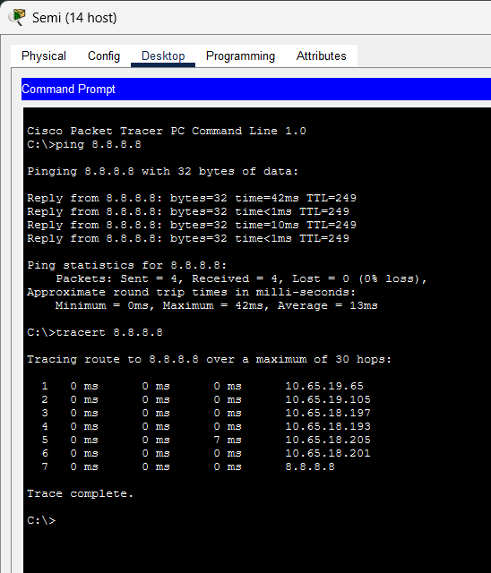

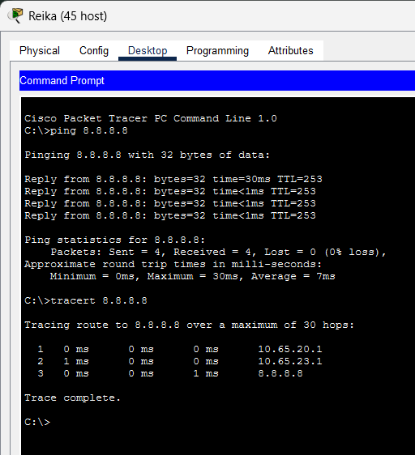

file revisi pkt: [revisi-pkt](./Praktikum-Jarkom-K-08-revisi.pkt)

- Pengelompokkan router... (iirc)

1. Sayap Bawah (blok 10.65.16.0/22)
B1 = A22 + A24 (tetangga di router Phantoma): A22 = 10.65.19.104/30 dan A24 = 10.65.19.108/30. Oktet 1 sampai 3 sama (24 bit). Oktet ke-4 berbeda: 104 = 01101|000 dan 108 = 01101|100, jadi 5 bit awal sama. Prefix = 24 + 5 = /29, NID = 10.65.19.104. Hasil: 10.65.19.104/29.
B2 = B1 + A21 (tetangga di router Knights): B1 = 10.65.19.104/29 dan A21 = 10.65.19.96/29. Oktet 1 sampai 3 sama (24 bit). Oktet ke-4 berbeda: 104 = 0110|1000 dan 96 = 0110|0000, jadi 4 bit awal sama. Prefix = 24 + 4 = /28, NID = 10.65.19.96. Hasil: 10.65.19.96/28.
B3 = B2 + A23 (tetangga di router Phantoma): B2 = 10.65.19.96/28 dan A23 = 10.65.19.64/27. Oktet 1 sampai 3 sama (24 bit). Oktet ke-4 berbeda: 96 = 01|100000 dan 64 = 01|000000, jadi 2 bit awal sama. Prefix = 24 + 2 = /26, NID = 10.65.19.64. Hasil: 10.65.19.64/26.
B4 = B3 + A25 (tetangga di router Shibuya): B3 = 10.65.19.64/26 dan A25 = 10.65.19.0/26. Oktet 1 sampai 3 sama (24 bit). Oktet ke-4 berbeda: 64 = 0|1000000 dan 0 = 0|0000000, jadi 1 bit awal sama. Prefix = 24 + 1 = /25, NID = 10.65.19.0. Hasil: 10.65.19.0/25.
B5 = A18 + A20 (tetangga di router Protocol7): A18 = 10.65.18.192/30 dan A20 = 10.65.18.196/30. Oktet 1 sampai 3 sama (24 bit). Oktet ke-4 berbeda: 192 = 11000|000 dan 196 = 11000|100, jadi 5 bit awal sama. Prefix = 24 + 5 = /29, NID = 10.65.18.192. Hasil: 10.65.18.192/29.
B6 = A14 + A16 (tetangga di router Tachibana): A14 = 10.65.18.200/30 dan A16 = 10.65.18.204/30. Oktet 1 sampai 3 sama (24 bit). Oktet ke-4 berbeda: 200 = 11001|000 dan 204 = 11001|100, jadi 5 bit awal sama. Prefix = 24 + 5 = /29, NID = 10.65.18.200. Hasil: 10.65.18.200/29.
B7 = B5 + B6 (tetangga di router Deus): B5 = 10.65.18.192/29 dan B6 = 10.65.18.200/29. Oktet 1 sampai 3 sama (24 bit). Oktet ke-4 berbeda: 192 = 1100|0000 dan 200 = 1100|1000, jadi 4 bit awal sama. Prefix = 24 + 4 = /28, NID = 10.65.18.192. Hasil: 10.65.18.192/28.
B8 = A19 + B7 (tetangga di router Protocol7): A19 = 10.65.18.128/26 dan B7 = 10.65.18.192/28. Oktet 1 sampai 3 sama (24 bit). Oktet ke-4 berbeda: 128 = 1|0000000 dan 192 = 1|1000000, jadi 1 bit awal sama. Prefix = 24 + 1 = /25, NID = 10.65.18.128. Hasil: 10.65.18.128/25.
B9 = A17 + B8 (tetangga di router Deus): A17 = 10.65.18.0/25 dan B8 = 10.65.18.128/25. Oktet 1 sampai 3 sama (24 bit). Oktet ke-4 berbeda: 0 = |00000000 dan 128 = |10000000, jadi 0 bit awal sama. Prefix = 24 + 0 = /24, NID = 10.65.18.0. Hasil: 10.65.18.0/24.
B10 = B9 + B4 (tetangga di router Knights): B9 = 10.65.18.0/24 dan B4 = 10.65.19.0/25. Oktet 1 sampai 2 sama (16 bit). Oktet ke-3 berbeda: 18 = 0001001|0 dan 19 = 0001001|1, jadi 7 bit awal sama. Prefix = 16 + 7 = /23, NID = 10.65.18.0. Hasil: 10.65.18.0/23.
B11 = A15 + B10 (tetangga di router Tachibana): A15 = 10.65.16.0/23 dan B10 = 10.65.18.0/23. Oktet 1 sampai 2 sama (16 bit). Oktet ke-3 berbeda: 16 = 000100|00 dan 18 = 000100|10, jadi 6 bit awal sama. Prefix = 16 + 6 = /22, NID = 10.65.16.0. Hasil: 10.65.16.0/22.
Hasil akhir: B11 = 10.65.16.0/22, sama dengan blok sayap bawah yang dihitung dari total host.
2. Sayap Kanan (blok 10.65.20.0/22)
C1 = A11 + A12 (tetangga di router Navi): A11 = 10.65.20.0/24 dan A12 = 10.65.21.0/26. Oktet 1 sampai 2 sama (16 bit). Oktet ke-3 berbeda: 20 = 0001010|0 dan 21 = 0001010|1, jadi 7 bit awal sama. Prefix = 16 + 7 = /23, NID = 10.65.20.0. Hasil: 10.65.20.0/23.
C2 = A13 + A10 (tetangga di router Navi): A13 = 10.65.22.0/24 dan A10 = 10.65.23.0/30. Oktet 1 sampai 2 sama (16 bit). Oktet ke-3 berbeda: 22 = 0001011|0 dan 23 = 0001011|1, jadi 7 bit awal sama. Prefix = 16 + 7 = /23, NID = 10.65.22.0. Hasil: 10.65.22.0/23.
C3 = C1 + C2 (tetangga di router Navi): C1 = 10.65.20.0/23 dan C2 = 10.65.22.0/23. Oktet 1 sampai 2 sama (16 bit). Oktet ke-3 berbeda: 20 = 000101|00 dan 22 = 000101|10, jadi 6 bit awal sama. Prefix = 16 + 6 = /22, NID = 10.65.20.0. Hasil: 10.65.20.0/22.
Hasil akhir: C3 = 10.65.20.0/22, sama dengan blok sayap kanan yang dihitung dari total host.
3. Sayap Kiri (blok 10.65.0.0/20)
D1 = A3 + A5 (tetangga di router Copland): A3 = 10.65.6.0/29 dan A5 = 10.65.6.64/26. Oktet 1 sampai 3 sama (24 bit). Oktet ke-4 berbeda: 0 = 0|0000000 dan 64 = 0|1000000, jadi 1 bit awal sama. Prefix = 24 + 1 = /25, NID = 10.65.6.0. Hasil: 10.65.6.0/25.
D2 = D1 + A6 (tetangga di router Copland): D1 = 10.65.6.0/25 dan A6 = 10.65.4.0/23. Oktet 1 sampai 2 sama (16 bit). Oktet ke-3 berbeda: 6 = 000001|10 dan 4 = 000001|00, jadi 6 bit awal sama. Prefix = 16 + 6 = /22, NID = 10.65.4.0. Hasil: 10.65.4.0/22.
D3 = A7 + A8 (tetangga di router Schumann): A7 = 10.65.8.0/29 dan A8 = 10.65.8.8/30. Oktet 1 sampai 3 sama (24 bit). Oktet ke-4 berbeda: 0 = 0000|0000 dan 8 = 0000|1000, jadi 4 bit awal sama. Prefix = 24 + 4 = /28, NID = 10.65.8.0. Hasil: 10.65.8.0/28.
D4 = D3 + A9 (tetangga di router Accela): D3 = 10.65.8.0/28 dan A9 = 10.65.12.0/22. Oktet 1 sampai 2 sama (16 bit). Oktet ke-3 berbeda: 8 = 00001|000 dan 12 = 00001|100, jadi 5 bit awal sama. Prefix = 16 + 5 = /21, NID = 10.65.8.0. Hasil: 10.65.8.0/21.
D5 = A4 + D2 (tetangga di router Psyche): A4 = 10.65.0.0/22 dan D2 = 10.65.4.0/22. Oktet 1 sampai 2 sama (16 bit). Oktet ke-3 berbeda: 0 = 00000|000 dan 4 = 00000|100, jadi 5 bit awal sama. Prefix = 16 + 5 = /21, NID = 10.65.0.0. Hasil: 10.65.0.0/21.
D6 = D5 + D4 (tetangga di router Schumann): D5 = 10.65.0.0/21 dan D4 = 10.65.8.0/21. Oktet 1 sampai 2 sama (16 bit). Oktet ke-3 berbeda: 0 = 0000|0000 dan 8 = 0000|1000, jadi 4 bit awal sama. Prefix = 16 + 4 = /20, NID = 10.65.0.0. Hasil: 10.65.0.0/20.
Hasil akhir: D6 = 10.65.0.0/20, sama dengan blok sayap kiri yang dihitung dari total host.
4. Sayap Atas (blok 10.65.24.0/24)
E1 = A1 + A2 (tetangga di router Cybertia): A1 = 10.65.24.0/25 dan A2 = 10.65.24.128/30. Oktet 1 sampai 3 sama (24 bit). Oktet ke-4 berbeda: 0 = |00000000 dan 128 = |10000000, jadi 0 bit awal sama. Prefix = 24 + 0 = /24, NID = 10.65.24.0. Hasil: 10.65.24.0/24.
Hasil akhir: E1 = 10.65.24.0/24, sama dengan blok sayap atas yang dihitung dari total host.
5. Penggabungan Antar Sayap (router pusat Wired)
F1 = B11 + C3 (tetangga di router Wired): B11 = 10.65.16.0/22 dan C3 = 10.65.20.0/22. Oktet 1 sampai 2 sama (16 bit). Oktet ke-3 berbeda: 16 = 00010|000 dan 20 = 00010|100, jadi 5 bit awal sama. Prefix = 16 + 5 = /21, NID = 10.65.16.0. Hasil: 10.65.16.0/21.
F2 = F1 + E1 (tetangga di router Wired): F1 = 10.65.16.0/21 dan E1 = 10.65.24.0/24. Oktet 1 sampai 2 sama (16 bit). Oktet ke-3 berbeda: 16 = 0001|0000 dan 24 = 0001|1000, jadi 4 bit awal sama. Prefix = 16 + 4 = /20, NID = 10.65.16.0. Hasil: 10.65.16.0/20.
F3 = D6 + F2 (tetangga di router Wired): D6 = 10.65.0.0/20 dan F2 = 10.65.16.0/20. Oktet 1 sampai 2 sama (16 bit). Oktet ke-3 berbeda: 0 = 000|00000 dan 16 = 000|10000, jadi 3 bit awal sama. Prefix = 16 + 3 = /19, NID = 10.65.0.0. Hasil: 10.65.0.0/19.
Hasil akhir: F3 = 10.65.0.0/19, satu route ringkasan yang mencakup seluruh jaringan.